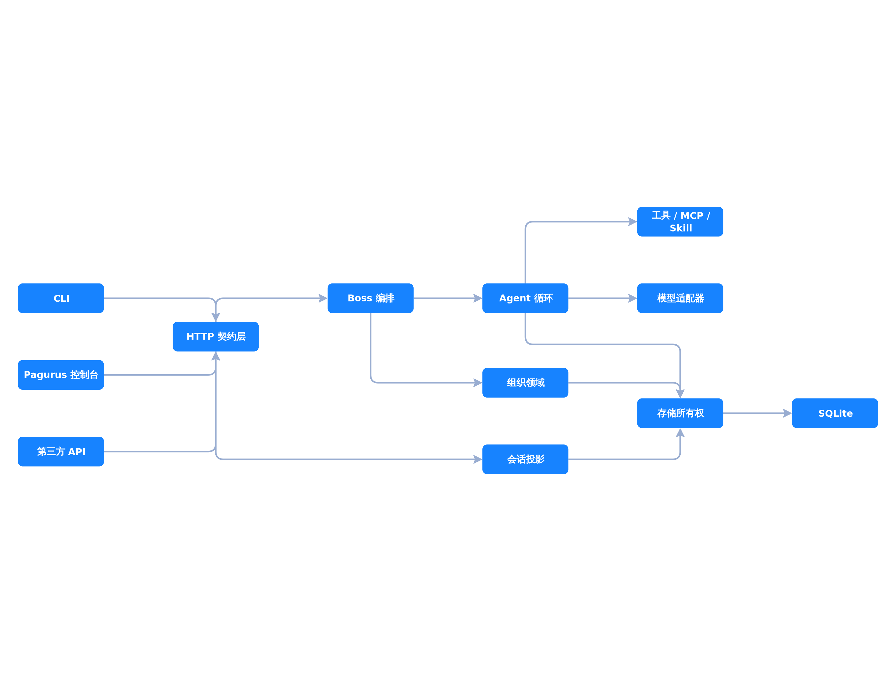

# 架构总览（2026-11-16 最新审阅）

> 图由 `generate_flow_diagram` 生成，节点名与仓库模块一一对应。本文是随代码更新的审阅结论，不是契约事实源；契约以 `docs/openapi.yaml` 与已接受 ADR 为准。

## 分层与依赖方向

自左向右是调用方向，不允许反向：

1. **客户端**（CLI / Pagurus 控制台 / 第三方 API）— 只通过版本化 HTTP 契约交互，不读私有文件或数据库。
2. **HTTP 契约层**（17 个主路由文件）— 负责传输与形状，不含业务判断。
3. **编排层** — `boss-mode-service`（意图→组织动作）与 `agent-chat`（会话投影）。
4. **执行层** — `task-service` 拥有 Agent 循环、工具排空、审批与预算。
5. **领域层** — `organization-contract` 与 `organization-validators` 是纯函数，无 I/O。
6. **存储所有权** — `task-store` 是唯一 SQLite 持有者；行接口与迁移 DDL 已拆到 `task-store-rows` / `task-store-migrations`，子存储通过同一个 `DatabaseSync` 访问。

## 审阅结论

**成立的部分**

- 依赖方向干净：领域层不 import 服务层，服务层不 import HTTP 层。
- 单一写入者成立：只有 `task-service` 构造 `SqliteTaskStore`，其余模块通过它访问。
- 适配器边界清晰：`magpie-provider`、`mcp-provider`、`skill-provider` 和默认关闭的 `git-tools` 都是可替换实现，不被领域代码直接依赖。
- ADR 0090–0094 后最大运行时文件为 `boss-mode-service.ts`（1241 行），四个运行时文件超过 1000 行；从 ADR 0090 前的 1518 行峰值明显下降。
- `agent-chat-store.ts` 已改为依赖 `agent-chat-types.ts`，原先 store ↔ service 的循环依赖已经消除。

**仍然存在的问题（按优先级）**

1. **`task-store.ts` 仍有 1076 行**：行接口和迁移 DDL 已拆出，但 store 仍持有任务、事件、Agent、work、platform、organization、agentChat、memory 等表的一组方法。它是唯一所有者这一点是对的，但「唯一所有者」不等于「一个文件」；下一步需要显式仓储接口，再做按表拆分。
2. **`boss-mode-service` 仍含生命周期批处理**（恢复、归档、下线），与「意图→动作」混在一起，是它剩下的主要耦合。纯恢复投影已拆到 `worker-execution-restore.ts`，但 `runLifecycleBatch` 仍与共享状态交织。
3. **并发缺失是结构性的**：`submit` 串行 `await` 每个派发的员工，`organization-execution` 只有并发上限而没有实际并发。这不是 bug，是尚未实现的能力；在引入并发前，需要先明确 `task-service` 的循环状态是否可重入。
4. **Git 工具仍是默认关闭的可选面**：ADR 0095 的 `git_status` / `git_diff` / `git_log` 使用固定 argv、`shell: false`、输出上限与路径边界，只提供版本控制上下文；没有 shell、写操作或任意参数入口。

**不建议做的事**

- 不要引入「调度中台」式独立服务：会成为第二个状态所有者，违反单一写入者不变量。
- 不要在 `task-store` 拆分前引入并发：现在循环与存储的所有权边界还不够细，并发会放大所有隐藏的共享状态。
- 不要为了便利把 Git 工具改成通用命令执行器：当前安全边界来自固定子命令与 `shell: false`，扩展 argv 会直接破坏这条边界。
