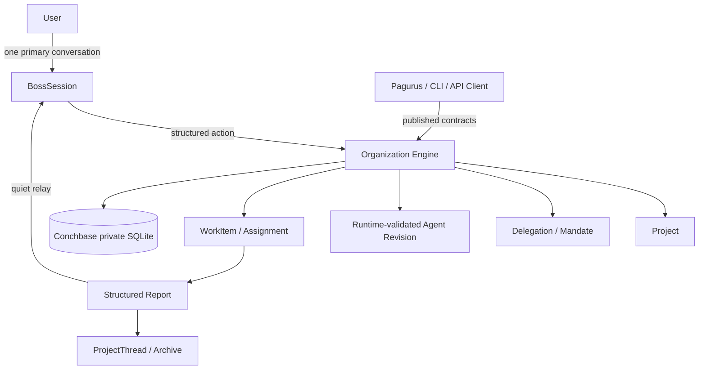

# 组织运行时最终目标规格

> 本文是中文目标说明，不是公开 API 契约事实源。英文 ADR、`docs/openapi.yaml`、已接受的契约文档与 `docs/PROJECT_STATUS.json` 仍是事实源。本文把 [ADR 0030](decisions/0030-organization-runtime-direction.md) 的产品方向展开为 AI 开发模型可以逐项完成、验证和交付的最终目标。

## 1. 最终目标

Conchbase 的最终目标不是“更多会话”或“更复杂的工作流编辑器”，而是：

> 用户始终只与一个入口 Agent 对话；入口 Agent 在 Runtime 授权边界内动态形成组织，员工 Agent 并发完成真实工作，结果以安静、结构化、可恢复的方式回到唯一主会话。

最终交付后的产品形态为：

- 用户只需要配置一个根 Agent，即可使用组织能力。
- 一个主会话承载所有用户意图，不为项目、员工或任务新增用户侧会话。
- 项目由主会话内容形成，拥有独立、持久、可归档、可恢复的执行上下文。
- 入口 Agent 或被授权招聘的 Agent 可以现场定义员工 Agent。
- 员工定义经 Runtime 校验后固化为不可变 Agent revision。
- 工作以 WorkItem / Assignment 为执行底座并发运行。
- 普通进度留在项目线程，主会话只在结果、问题、失败和重要汇报时发声。
- 项目安静后形成结构化报告，项目线程归档，活跃授权撤销，历史永久保留。
- CLI、Pagurus 和第三方 UI 都通过版本化 Runtime 契约使用同一能力，不产生第二套状态。

## 2. 已完成基线与目标差距

`1.0.0` 已完成：Agent identity/revision、provider-neutral model reference、Task、deterministic composition、tool request ledger、durable work、SecretHandle、capability directory、local Source、authenticated pairing metadata、47-path OpenAPI 与单实例 SQLite。

完整组织目标尚未实现。差距是：

| 领域 | 1.0.0 基线 | 最终目标 |
| --- | --- | --- |
| 会话 | 无一等主会话，用户按任务交互 | 一等 BossSession，唯一用户入口 |
| 项目 | Thread/WorkItem 近似一对一 | 一个主会话对应多个持久 Project |
| 员工 | 用户先定义 Agent，再绑定任务 | 模型提出定义，Runtime 校验并创建不可变 revision |
| 授权 | 静态 Mandate 与 capability directory | 父子 Delegation，能力只收缩不扩张 |
| 并发 | 工作状态机存在，调度策略有限 | 有界 worker slots、用户交互优先、项目隔离 |
| 汇报 | 任务输出与事件 | 结构化 ProjectReport、AttentionRequest、安静 relay |
| 生命周期 | WorkItem 有 end 状态 | Idle → report → archive → offboard → resume/revalidate |
| 客户端 | 47 路径控制台 | Organization Console，只展示 published state |

## 3. 必须实现的能力

### 3.1 主会话与项目

Runtime 必须持久化一个 `BossSession` 或等价一等对象。它是唯一接收用户自然语言的执行入口，并关联多个 `Project`。

每个 `Project` 至少具备：

- 稳定身份和版本；
- 来源主会话消息或 Trigger 的可追溯引用；
- 项目状态：forming / active / quiet / archived / stopped / resumed；
- 关联的 Agent revision、Delegation、WorkItem 和 ProjectThread；
- 结构化报告历史；
- 恢复所需的 Mandate 快照与 policy 版本；
- 不由自然语言单独决定的机器状态。

`ProjectThread` 与 `BossSession` 必须分离。主线程接收用户意图和少量汇报，项目线程承载细节、进度和历史。项目线程不能被客户端呈现为另一个用户必须维护的会话。

### 3.2 动态 Agent 定义

老板 Agent 或具备 recruiting capability 的 Agent 可以提出员工 Agent 定义。Runtime 必须：

1. 从模型输出中解析结构化 `create_agent` 动作；
2. 校验字段、引用、能力、预算和父级授权；
3. 生成不可变 Agent revision；
4. 记录创建者、父级 Delegation 与 policy 版本；
5. 在同一事务中建立 Delegation、Mandate 和初始 WorkItem 关系；
6. 拒绝任何未声明、越权或secret-like字段。

模型输出绝不是授权。Agent 定义、Skill 名称、模型偏好、capability 引用和自然语言指令都不能扩大 Runtime 权限。

模板不是前置条件。成功 revision 后续可被提升为模板，但该能力必须有独立 ADR。

### 3.3 HR / 招聘能力

“HR”只是具备 `can_delegate` 能力的 Agent 行为，不是固定角色 schema。招聘关系必须形成一棵有界 Delegation 图：

- 子级 scope 必须是父级 scope 的子集；
- 子级 capability 必须是父级 capability 的子集；
- 子级 budget、TTL、recursion depth 必须小于或等于父级剩余额度；
- 父级必须记录它授权了哪些子级；
- 子级不能把已撤销或已失效的 Mandate 再传下去；
- 任何递归招聘必须可追踪、可停止、可审计。

HR 可以由老板创建，员工也可以被授予招聘能力。系统不得假设固定层数、固定角色名或固定组织树。

### 3.4 WorkItem 与并发

组织运行时复用现有 work contract，而不是另建执行核心。每个员工工作至少绑定：

- 一个 Agent revision；
- 一个配置/policy/capability revision；
- 一个 provider-neutral model reference；
- 一个父级 Delegation；
- 一个 WorkItem；
- 一个或多个 Assignment；
- 一个 ProjectThread；
- 结构化 Reports。

并发目标：

- 多个项目可并发；
- 一个项目内部也可有多个 WorkItem，但受项目级限制；
- 全局 worker slots 由 Runtime 策略控制；
- 用户消息、停止请求和 Attention 回答优先于新工作启动；
- 慢任务不得阻塞主会话；
- 汇报进入主会话时必须串行化；
- worker 不能直接写主会话。

### 3.5 Report 与 Attention

所有 worker 必须向 Runtime 报告结构化状态。最终词汇可由实现 ADR 固定，但语义必须覆盖：

| 状态 | 含义 |
| --- | --- |
| draft | 尚未形成可交付结论 |
| progress | 正常进展，通常只进入项目线程 |
| waiting | 等待 Trigger、输入或外部条件 |
| ready | 结果可供用户或上级消费 |
| blocked | 遇到障碍，需人工或上级输入 |
| failed | 执行失败 |
| attention | 有具体问题需要用户回答 |
| ended | 工作结束 |

`waiting_on_human` 必须是结构化事实。任何从自由文本推断“在等你”的实现都不符合目标。

AttentionRequest 必须包含：

- 稳定身份；
- 项目与工作引用；
- 一个具体问题；
- 可选的结构化回答约束；
- 超时/撤回策略；
- 回答后恢复哪个 WorkItem。

### 3.6 归档、Offboard 与恢复

项目安静与回收由 Runtime policy 决定，不由模型一句话决定。过程为：

1. Runtime 检测到项目满足 idle 条件；
2. Runtime 请求或生成一个结构化 ProjectReport；
3. 主会话收到简短汇报；
4. 详细历史移入 ProjectThread；
5. 项目进入 archived；
6. 活跃员工授权被撤销，即 offboard；
7. running Assignment 按明确状态机 interrupted / cancelled / ended；
8. 用户后来提及该项目时，Runtime 先 revalidate Mandate 与 policy；
9. 通过验证后创建新 Assignment，而不是伪精确重放旧模型调用。

任何 offboard 都不得删除事件、报告、输出、决策或项目线程。

### 3.7 安全与不变量

完整组织能力必须继续满足：

- Conchbase 是唯一执行权威；
- Pagurus/CLI/第三方 UI 都是客户端；
- 默认 loopback-only；
- UI 不读私有文件或数据库；
- SecretHandle 明文不进入模型、提示词、任务、事件、日志、错误、客户端、Agent revision 或配置文档；
- 没有 generic secret resolver；
- Skill 只提供指令，不授予权限；
- 工具不能绕过 policy 与 approval；
- provider adapter 可替换，Magpie 不是产品契约；
- 拓扑中立，老板/HR/员工不是 schema 枚举；
- 1.0.0 Task 与 WorkItem 语义不被偷换。

## 4. 最终架构

职责：

- `BossSession`：唯一用户入口，接收意图和少量汇报。
- `Organization Engine`：结构化动作的唯一写入者。
- `Project`：持久工作主题。
- `Delegation / Mandate`：谁授权谁、在哪个范围内、到何时。
- `Agent Revision`：Runtime 接受并固化的员工定义。
- `WorkItem / Assignment`：既有执行底座。
- `ProjectThread`：项目细节与历史。
- `Pagurus / CLI`：只通过已发布契约发意图、读状态。

## 5. 必须补完的契约

后续 ADR 必须把以下契约逐个定稿。目标模式不允许实现时临时发明：

### 5.1 内部领域契约

- Organization domain model 与状态机；
- `create_agent` / delegate / report / offboard / archive / resume 的结构化动作；
- 模型输出解析与 Runtime command 的边界；
- Agent revision 创建与既有 `/v1/agents` 的关系；
- Delegation 继承、预算、TTL、recursion depth；
- ProjectThread 与 BossSession 的消息边界；
- 事件类型、payload 边界与 retention；
- idle detection、revalidation、resume 规则。

### 5.2 公开 Runtime 契约

在单独的版本化公共契约 ADR 之前，47 路径冻结。最终公开契约必须定义：

- 主会话读与发意图；
- 项目列表、详情和状态；
- 动态 Agent 提案/详情/审计视图；
- Delegation 与授权边界视图；
- WorkItem 与 Assignment 的组织视图；
- Report 与 AttentionRequest 的读取、回答、撤回；
- archive、offboard、resume 的控制语义；
- 组织事件订阅或游标读取语义；
- 所有错误、冲突和权限拒绝结构。

公开契约不得把内部模型草稿暴露成可执行状态，也不得让客户端自行计算权限。

### 5.3 Pagurus 契约

Pagurus 最终必须具备：

- 单一主会话界面；
- Attention-first Overview；
- Project Tree；
- Delegation / Worker Inspector；
- Report / Archive 浏览；
- 明确的确认与危险操作边界；
- 只读审计视图；
- 基于 published capability 的门禁；
- 键盘导航、可见焦点、reduced motion、响应式布局；
- 与 published OpenAPI 对齐的 typed client fixture。

Pagurus 不得：

- 读写私有文件/数据库；
- 本地创建 Agent revision；
- 本地计算授权结果；
- 把 mock 当 live；
- 生成第二套 schema；
- 把项目线程变成另一个用户会话。

## 6. 验证矩阵

最终目标只有在以下夹具全部存在并通过后才算完成：

### 6.1 Conchbase

- 多项目并发 fixture；
- 用户消息优先于 queue 的 fixture；
- 动态 `create_agent` 校验/拒绝 fixture；
- delegation 越权、递归超限、TTL 过期 fixture；
- structured report 状态转换 fixture；
- attention request 创建、回答、撤回、超时 fixture；
- idle → report → archive → offboard fixture；
- archive → revalidate → resume fixture；
- crash/restart 恢复与重复投递幂等 fixture；
- no plaintext secret exposure fixture；
- no canonical topology / no role enum guardrail；
- public OpenAPI contract fixture。

### 6.2 Pagurus

- primary conversation 与 project thread 边界 fixture；
- attention ordering fixture；
- worker/delegation inspector 只读 fixture；
- archive/report 浏览 fixture；
- destructive action confirmation fixture；
- no private Runtime access fixture；
- no second schema fixture；
- keyboard/focus/reduced-motion/responsive fixture；
- published contract alignment fixture。

### 6.3 双仓

- 使用 fake provider 的确定性端到端组织运行 fixture；
- 一个主会话、多个项目、并发 worker、一次人工回答、一次归档恢复的完整路径；
- 两仓 `npm run check`、`npm test`、`npm run build` 通过；
- CI 中全部可重复，无真实凭证与外部服务。

## 7. 最终状态定义

只有当 `docs/PROJECT_STATUS.json` 同时满足以下条件时，才可以把组织目标标为完成：

- `implemented` 包含 `organization-runtime`；
- `implemented` 包含 `dynamic-agent-revisions`；
- `implemented` 包含 `bounded-delegation`；
- `implemented` 包含 `concurrent-project-work`；
- `implemented` 包含 `structured-reporting`；
- `implemented` 包含 `archive-offboard-resume`；
- `validationEvidence` 包含上节所有可执行夹具；
- `blockedDirections` 只保留确实未实现的外部边界；
- `nextBoundedSlices` 中不再有组织目标相关条目；
- Pagurus status 对应记录 `organization-console`。

在此之前，ADR 0030 与 Pagurus ADR 0015 只代表已接受方向，不代表已实现。

## 8. 交付顺序

目标很远，但必须按顺序收敛：

1. Organization domain ADR：对象、状态机、事件、唯一写入者。
2. Dynamic Agent / Delegation ADR：模型动作、revision、授权收缩、预算与 TTL。
3. Concurrency / Report ADR：worker slots、用户优先、report、attention、relay。
4. Archive / Resume ADR：idle、offboard、archive、revalidation、recovery。
5. Organization API ADR：版本化公开契约，明确 1.1 或后续版本。
6. Pagurus Organization Console ADR：对应客户端契约与界面边界。
7. 实现内部领域与持久化夹具。
8. 实现 Runtime 执行与报告夹具。
9. 实现公开 API 与 Pagurus 客户端。
10. 双仓端到端组织 fixture 通过。
11. 更新 status/objective/handoff/README，完成最终发布。

每一步必须留下可执行验证。不得用“后续再补测试”推进下一步。

## 9. 辩证取舍

这条路比模板优先、固定角色、多会话方案难，因为模型要在运行时写定义，而 Runtime 必须在没有人类逐项审核的情况下保证安全。但它更接近用户的真实需求：用户只想表达意图，不想维护组织图。

因此，本项目选择“模型提出定义，Runtime 裁决授权；员工动态产生，历史结构化保存；用户只看一个入口，系统承担并发复杂度”。这是产品方向，不是当前实现承诺。

> 目标模式不是宣布完工，而是把远目标固定下来，让每个后续 AI 开发模型按同一目标连续推进。
